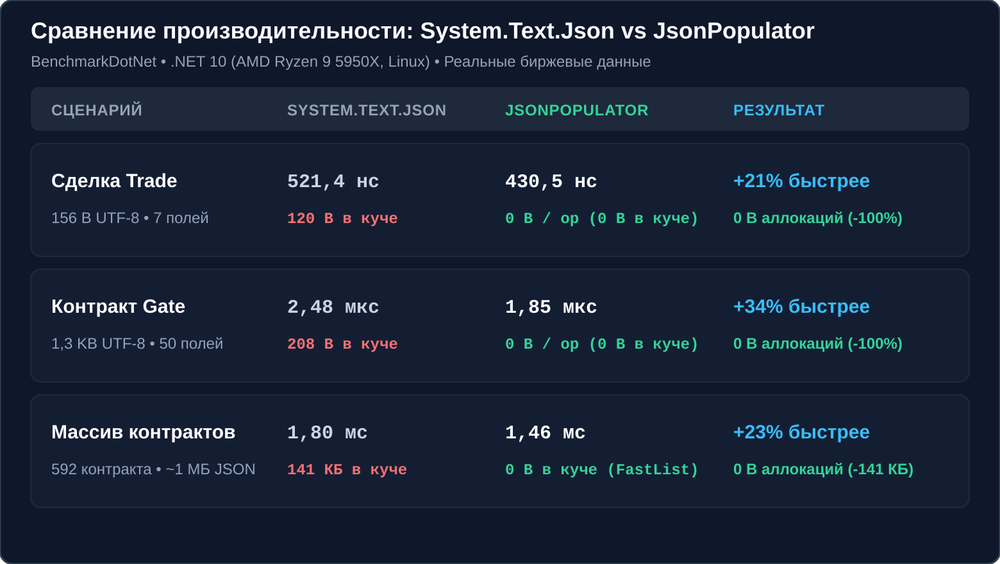
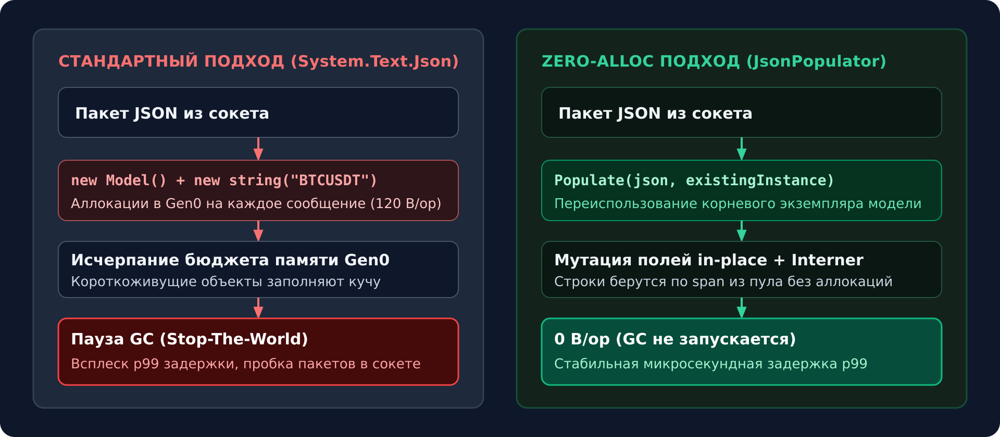
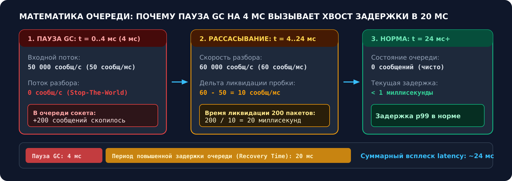
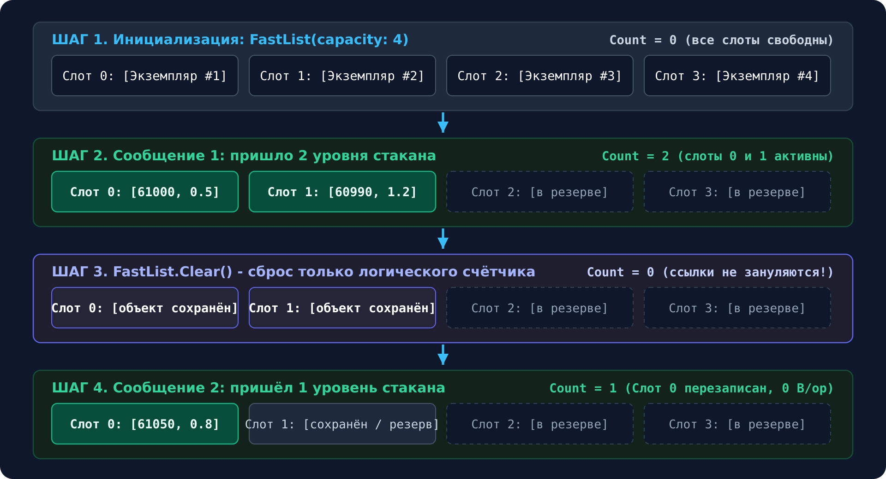
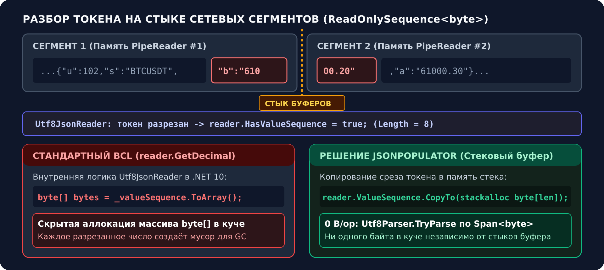
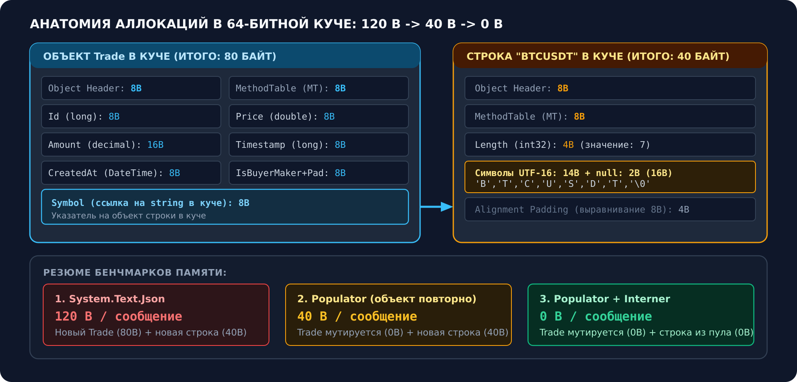

# 0 B/op и на 34% быстрее System.Text.Json: парсинг JSON в существующие объекты в .NET

[](https://raw.githubusercontent.com/mzaprudin/articles/main/zero-alloc-json/assets/00-cover-benchmark-780x440.png)

На криптобирже происходит резкий ценовой импульс. Торговая активность взлетает, обновления стакана и потока сделок сыплются десятками тысяч в секунду, а торговому движку или арбитражному сервису необходимо за минимальное время рассчитать новую справедливую цену. 

В высоконагруженных криптосервисах нельзя просто перейти на компактные бинарные протоколы вроде SBE (Simple Binary Encoding), FlatBuffers или Protobuf: публичные WebSocket API бирж (Binance, Bybit, Gate, OKX) отдают потоки рыночных данных **исключительно в текстовом формате JSON**. Если на каждое входящее сообщение сервис десериализует JSON в новый набор управляемых объектов, он быстро создаёт высокую нагрузку на сборщик мусора (GC pressure).

В момент, когда сборщик мусора ставит поток обработки на паузу, входящий сокет продолжает буферизовать пакеты. Задержка обработки растёт, и к моменту вычитки котировки успевают устареть. На быстром рынке даже пауза в единицы миллисекунд приводит к проскальзыванию (slippage) и исполнению ордеров по невыгодным ценам. [Торговая активность и волатильность](https://doi.org/10.1007/s11156-024-01304-1) · [Задержки и цена исполнения](https://ora.ox.ac.uk/objects/uuid%3Acdab1de2-7576-42e2-abae-ab12371eba76/files/rs4655j600)

Чтобы устранить этот фактор, был разработан парсер `JsonPopulator`. Его задача - десериализовать JSON-сообщения прямо в **существующие экземпляры классов и структур**, переиспользуя строковые значения и внутренние списки без единой аллокации в куче (0 B/op). Исходный код решения, тесты и воспроизводимые бенчмарки опубликованы в открытом репозитории [zero-alloc-json на GitHub](https://github.com/mzaprudin/zero-alloc-json).

Ниже разбор того, почему `System.Text.Json` не решает эту задачу из коробки, как устроена архитектура безаллокационного парсинга в .NET, где в базовой библиотеке классов (Base Class Library, BCL) прячутся скрытые аллокации на стыках сетевых буферов и что показывают бенчмарки на реальных биржевых данных.

<cut>

[](https://raw.githubusercontent.com/mzaprudin/articles/main/zero-alloc-json/assets/01-approach-comparison.png)

## Как постоянные аллокации влияют на задержки

Создание единичного небольшого объекта в .NET происходит предельно быстро - это просто сдвиг указателя в Gen0. Однако при непрерывном потоке в десятки тысяч сообщений в секунду этот бюджет мгновенно исчерпывается. 

Рассмотрим математику очереди на конкретном примере:
1. На вход сокета поступает поток **50 000 сообщений в секунду** (то есть ровно 50 сообщений в каждую миллисекунду).
2. Сборщик мусора запускает Stop-The-World паузу всего на **4 миллисекунды**. На это время поток разбора полностью замирает.
3. Сеть и сокет продолжают принимать пакеты: за 4 мс в очереди сокета скапливается $4 \times 50 = \mathbf{200 \text{ сообщений}}$.
4. Пауза закончилась, обработчик просыпается и начинает вычитывать очередь со своей максимальной скоростью - **60 000 сообщений в секунду**.
5. Но поток новых данных не прекращался - параллельно с разбором продолжают поступать те же 50 000 сообщений в секунду. Пробка рассасывается лишь с разницей скоростей: $60\,000 - 50\,000 = 10\,000 \text{ сообщ/с}$ (или 10 сообщений в миллисекунду).
6. Чтобы ликвидировать накопившиеся 200 сообщений со скоростью 10 сообщ/мс, системе требуется:
   $$\frac{200 \text{ сообщений}}{10 \text{ сообщ/мс}} = \mathbf{20 \text{ миллисекунд}}.$$

Все эти 20 мс в очереди физически находятся необработанные сообщения. Любой новый пакет, пришедший *после* завершения паузы GC, встаёт в хвост пробки и ждёт вычитки предыдущих. В результате пауза GC длилась всего 4 мс, а период деградации задержки (recovery time) растянулся ещё на 20 мс - суммарно почти 25 мс всплеска задержки.

[](https://raw.githubusercontent.com/mzaprudin/articles/main/zero-alloc-json/assets/02-queue-latency-spike.png)

Метрика среднего времени отклика за сутки полностью маскирует такие эпизоды. В критических подсистемах ключевой ориентир - перцентили `p99` и `p99.9`. Чтобы обнаружить причину всплесков, метрики аллокаций, задержек и паузы GC сопоставляют на единой временной шкале через встроенные счетчики рантайма или `dotnet-trace`. [Метрики среды .NET](https://learn.microsoft.com/en-us/dotnet/core/diagnostics/built-in-metrics-runtime) · [Трассировка через dotnet-trace](https://learn.microsoft.com/en-us/dotnet/core/diagnostics/dotnet-trace)

## Почему стандартный System.Text.Json не решает задачу

Начиная с .NET 8 в библиотеке `System.Text.Json` (STJ) появился атрибут `[JsonObjectCreationHandling(JsonObjectCreationHandling.Populate)]`. Однако он предназначен для совершенно другого сценария и не обеспечивает zero-alloc разбор входящего потока.

### Что на самом деле делает Populate в STJ?

По умолчанию в STJ действует стратегия `Replace`: если внутри десериализуемого класса свойство уже проинициализировано (например, `public Address Info { get; set; } = new();`), парсер создаёт **новый** объект `Address` и заменяет ссылку.

Режим `Populate` указывает парсеру: *«не создавай новый вложенный объект, а заполни свойства уже существующего экземпляра в поле/свойстве»*:

```cs
// Как работает Populate в System.Text.Json:
public class TradeMessage
{
    // Вложенный объект: в режиме Populate STJ заполнит поля этого экземпляра
    public TradeDetails Details { get; set; } = new TradeDetails();
}

// Но сам метод Deserialize ВСЕГДА аллоцирует новый корневой TradeMessage!
var msg = JsonSerializer.Deserialize<TradeMessage>(jsonUtf8, options);
```

### Почему этого недостаточно для zero-alloc

1. **Корень всегда создаётся заново:** Сигнатура `JsonSerializer.Deserialize<T>(...)` всегда возвращает новый экземпляр `T`. В BCL нет перегрузки вида `JsonSerializer.DeserializeInto(json, existingInstance)`. На каждый входящий пакет рантайм выделяет в куче новый корневой объект.
2. **Строки продолжают выделять память:** На каждое строковое свойство (`"Symbol": "BTCUSDT"`) стандартный десериализатор создаёт новый `System.String`. В STJ нет встроенного механизма интернирования строк по `ReadOnlySpan<char>` без предварительной аллокации строки.
3. **Коллекции порождают мусор:** При разборе списков переменной длины стандартный механизм либо создаёт новую коллекцию, либо зануляет ссылки на элементы, не позволяя переиспользовать уже выделенные объекты.

<spoiler title="Почему не помогла кастомная фабрика JsonTypeInfo<T>.CreateObject?">

Иногда пытаются обойти ограничение через метаданные типа: `typeInfo.CreateObject = () => myReusableInstance;`.

В реальном коде это не работает:
- **Нет контекста вызова и потокобезопасности:** Сигнатура `CreateObject` - это `Func<object>?`. Делегат привязан к глобальным метаданным `JsonTypeInfo` и не знает, какой именно инстанс вызывающий код хочет заполнить сейчас. Если два потока десериализуют сообщения параллельно, возврат общего объекта приведёт к гонке данных.
- **Остальные аллокации никуда не исчезают:** Даже если вернуть готовый корневой объект, STJ продолжит аллоцировать строки (`string Symbol`) и внутренние массивы коллекций. Честных 0 B/op так не получить.

</spoiler>

Чтобы получить честные 0 байт на операцию, парсер должен принимать готовый экземпляр снаружи и мутировать его свойства на месте без посредников.

## Как устроен JsonPopulator: разбор в существующий объект

Рассмотрим базовое сообщение о лучших ценах стакана (book ticker): номер обновления `u`, торговая пара `s`, лучшая цена покупки `b` и лучшая цена продажи `a`. [Формат bookTicker в Binance Spot](https://github.com/binance/binance-spot-api-docs/blob/master/web-socket-streams.md#individual-symbol-book-ticker-streams)

```cs
var quote = new TopOfBook();

// Первое сообщение: заполняем существующий экземпляр
JsonPopulator.Populate(
    """{"u":101,"s":"BTCUSDT","b":"61000.00","a":"61000.10"}"""u8, quote);

// Второе сообщение: повторно используем тот же объект в памяти
JsonPopulator.Populate(
    """{"u":102,"s":"BTCUSDT","b":"61000.20","a":"61000.30"}"""u8, quote);

// quote содержит обновление 102 без единой аллокации
```

Если целевой тип объявлен как структура (`struct`), передаём его по ссылке через `ref T`, исключая лишнее копирование байтов в стеке.

### Поведение при частичных обновлениях

`JsonPopulator` мутирует только те поля, которые присутствуют во входном JSON. Если биржа присылает компактное обновление только с ценой покупки `{"b":"61000.20"}`, остальные поля объекта сохранят свои предыдущие значения. 

Такой подход удобен для поддержания локального стакана (Local Order Book), где биржа шлёт только изменившиеся уровни. Если же потребителю требуется чистый объект на каждое сообщение, вызывающий код должен сбросить поля перед разбором либо реализовать интерфейс очистки.

## Архитектура диспетчеризации полей «под капотом»

Как сопоставлять JSON-ключи со свойствами C#-класса максимально быстро и без аллокаций?

Обычный `Dictionary<string, Action>` требует аллокации строки для поиска ключа. Использование рефлексии в рантайме недопустимо из-за просадки производительности.

В `JsonPopulator<T>` применён статический кэш метаданных с двухуровневой оптимизацией:
1. **Группировка по длине имени (`Bucket by Length`):** имена свойств заранее кодируются в UTF-8 байты. В статическом конструкторе типа строится массив массивов `PropertyLookupEntry[][] _lookup`, где внешним индексом выступает точная длина имени свойства в байтах.
2. **Векторное сравнение (SIMD) через `ValueTextEquals`:** при разборе парсер считывает токен `PropertyName`, мгновенно выбирает корзину по длине и сравнивает байты токена с байтами зарегистрированных свойств через `reader.ValueTextEquals(...)`.
3. **Прямой вызов скомпилированного сеттера:** для каждого свойства заранее скомпилирован строго типизированный делегат, записывающий значение в поле целевого объекта.

<spoiler title="Фрагмент горячего цикла диспетчеризации полей в JsonPopulator">

```cs
// Упрощённый фрагмент горячего цикла диспетчеризации в JsonPopulator
while (reader.Read())
{
    if (reader.TokenType == JsonTokenType.EndObject) return;

    if (reader.TokenType == JsonTokenType.PropertyName)
    {
        int len = reader.HasValueSequence ? (int)reader.ValueSequence.Length : reader.ValueSpan.Length;

        if (len >= _minLen && len <= _maxLen)
        {
            var candidates = _lookup[len];
            if (candidates is not null)
            {
                bool found = false;
                for (int i = 0; i < candidates.Length; i++)
                {
                    ref readonly var entry = ref candidates[i];
                    // ValueTextEquals использует векторные инструкции (SIMD) и корректно читает ReadOnlySequence
                    if (reader.ValueTextEquals(entry.NameBytes))
                    {
                        reader.Read(); // Переходим к токену значения
                        entry.Action(ref target, ref reader, interner);
                        found = true;
                        break;
                    }
                }
                if (!found) reader.Skip();
            }
            else reader.Skip();
        }
        else reader.Skip();
    }
}
```

</spoiler>

Благодаря группировке по длине отсекается до 90% нерелевантных свойств ещё до первого байтового сравнения, а вызов `reader.ValueTextEquals` не выделяет ни одного байта памяти.

### Привязка полей и позиционный разбор через атрибуты

Для связывания модели с JSON используются как стандартные атрибуты, так и специализированные:

```cs
sealed class TopOfBook
{
    [JsonPropertyName("u")]
    public long UpdateId { get; set; }

    [JsonPropertyName("s"), JsonIntern]
    public string Symbol { get; set; } = string.Empty;

    [JsonPropertyName("b")]
    public decimal Bid { get; set; }

    [JsonPropertyName("a")]
    public decimal Ask { get; set; }
}
```

В биржевых протоколах уровни стакана часто передаются в виде компактных кортежей в массиве: `["61000.00", "0.12"]`, где первый элемент - цена, а второй - объём. Для разбора таких структур служит атрибут `[JsonPosition(n)]`:

```cs
sealed class PriceLevel
{
    [JsonPosition(0)]
    public decimal Price { get; set; }

    [JsonPosition(1)]
    public decimal Quantity { get; set; }
}

var level = new PriceLevel();
JsonPopulator.Populate("""["61000.00","0.12"]"""u8, level);
```

Парсер преобразует такие модели в индексную таблицу переходов, считывая элементы массива по порядку без накладных расходов.

## Безаллокационное интернирование строк

Переиспользование самого объекта решает только часть проблемы. В каждом сообщении по паре `BTCUSDT` приходит строковый тикер. Стандартный вызов `reader.GetString()` создаёт новую строку в куче на каждое сообщение.

Вызов `string.Intern(reader.GetString())` ситуацию не спасает: чтобы передать строку интернеру, её сначала нужно получить через `GetString()`, а значит, объект строки уже создан и учтён сборщиком мусора.

Для решения этой проблемы в `JsonPopulator` встроен механизм интернирования через span. Для свойств, помеченных атрибутом `[JsonIntern]`, парсер декодирует UTF-8 во временный буфер на стеке (`stackalloc char[...]`) и передаёт `ReadOnlySpan<char>` в интернер.

Начиная с .NET 9 в `ConcurrentDictionary` появился метод `GetAlternateLookup`. Он позволяет выполнять поиск по ключу альтернативного типа (в нашем случае `ReadOnlySpan<char>`) в словаре `ConcurrentDictionary<string, string>` **без создания временного объекта строки при поиске**:

```cs
public sealed class SimpleStringInterner
{
    private readonly ConcurrentDictionary<string, string> _pool = new(StringComparer.Ordinal);

    public string Intern(ReadOnlySpan<char> chars)
    {
        // Поиск по ReadOnlySpan<char> без аллокаций благодаря .NET 9+ Alternate Lookup
        var lookup = _pool.GetAlternateLookup<ReadOnlySpan<char>>();
        if (lookup.TryGetValue(chars, out var existing))
        {
            return existing;
        }

        // Новая строка создаётся ровно один раз - при первом обнаружении нового тикера
        string value = new(chars);
        return _pool.GetOrAdd(value, value);
    }
}
```

```cs
var interner = new SimpleStringInterner();
StringInternerDelegate intern = interner.Intern;
var quote = new TopOfBook();

JsonPopulator.Populate("""{"s":"BTCUSDT"}"""u8, quote, intern);
string firstSymbol = quote.Symbol;

JsonPopulator.Populate("""{"s":"BTC\\u0055SDT"}"""u8, quote, intern);
bool reused = ReferenceEquals(firstSymbol, quote.Symbol); // true: ссылка идентична
```

Если тикеры известны заранее (например, при подписке на 50 пар), интернер можно прогреть до старта торговой сессии, сведя аллокации строк к абсолютному нулю.

### Альтернатива: FixedString без объектов

Если строковое представление нужно исключительно как идентификатор или для последующей отправки в сокет, можно полностью отказаться от ссылочного типа `string` в пользу структур `FixedString8`-`FixedString128`. Они хранят байты прямо в теле структуры в буфере фиксированного размера, полностью исключая обращение к куче.

## Коллекции переменной длины: почему List&lt;T&gt; не подходит и зачем нужен FastList

При разборе списков переменной длины возникает отдельная сложность: в одном обновлении стакана приходит 5 уровней, в следующем - 12, а затем - всего 2.

Как ведёт себя стандартный `List<T>`?
1. Метод `List<T>.Clear()` в CoreCLR выполняет `Array.Clear(_items, 0, _size)`. Он **зануляет ссылки на все элементы** в освободившихся слотах массива, чтобы ссылки не удерживали память.
2. При следующем сообщении парсеру приходится заново вызывать `new PriceLevel()` на каждый элемент, перечёркивая весь выигрыш от переиспользования списка.

```cs
// Поведение BCL List<T>.Clear():
Array.Clear(_items, 0, _size); // Все ссылки стёрты! Объекты отправляются в мусор.
_size = 0;
```

Для решения этой проблемы была разработана специализированная коллекция `FastList<T>`.

### Как устроен FastList&lt;T&gt;

1. При инициализации `FastList<T>` сразу выделяет внутренний массив заданной ёмкости (например, 64 слота) и **предварительно заполняет каждый слот живым экземпляром объекта** (если `T` - класс).
2. Метод `Clear()` сбрасывает **только счётчик `_count = 0`**, не трогая ссылки в массиве!
3. Парсер запрашивает следующий элемент через метод `AddAndGetRef()`, который инкрементирует `_count` и возвращает ссылку `ref T` на уже существующий объект в слоте массива.
4. Парсер мутирует поля существующего объекта без создания `new T()`.

[](https://raw.githubusercontent.com/mzaprudin/articles/main/zero-alloc-json/assets/03-fastlist-lifecycle.png)

```cs
sealed class DepthUpdate
{
    [JsonPropertyName("b")]
    public FastList<PriceLevel> Bids { get; } = new(64);
}

var update = new DepthUpdate();

// Первое обновление: 2 уровня
JsonPopulator.Populate("""{"b":[["61000","0.12"],["60999","0.34"]]}"""u8, update);
var secondSlot = update.Bids[1];

// Второе обновление: всего 1 уровень (Count становится равен 1)
JsonPopulator.Populate("""{"b":[["61001","0.20"]]}"""u8, update);
Console.WriteLine(update.Bids.Count); // 1

// Третье обновление: снова 2 уровня
JsonPopulator.Populate("""{"b":[["61002","0.25"],["61000","0.10"]]}"""u8, update);
bool reused = ReferenceEquals(secondSlot, update.Bids[1]); // true! Объект тот же.
```

Если число элементов превышает исходную ёмкость, `FastList` выполняет аварийное расширение массива (`Expand()`), гарантируя корректность работы даже при аномальных всплесках глубины стакана.

> [!WARNING]
> **Осторожно с устаревшими данными (Stale Data):** Если в объекте уровня стакана есть поля, которые приходят не в каждом сообщении, переиспользованный объект сохранит значения из предыдущего цикла. Для таких случаев в `FastList` предусмотрен метод `Reset()`, вызывающий `IFastResettable.Reset()` у использованных элементов.

## Границы сетевых буферов и подводные камни BCL

В сетевых пайплайнах на базе `System.IO.Pipelines` сообщения поступают в виде цепочек сегментов `ReadOnlySequence<byte>`. Полезная нагрузка JSON может быть произвольно разрезана на границе двух страниц памяти.

`Utf8JsonReader` корректно обрабатывает такие последовательности, выставляя флаг `HasValueSequence = true`, если текущий токен оказался разрезан между сегментами.

Для строковых чисел на стыке сегментов `JsonPopulator` копирует байты токена в компактный буфер на стеке через `stackalloc` и передаёт непрерывный срез в `Utf8Parser`:

```cs
// Токен String на границе двух сетевых сегментов (например, "b":"61000.20")
int length = (int)reader.ValueSequence.Length;
Span<byte> token = length <= 128 ? stackalloc byte[length] : new byte[length];
reader.ValueSequence.CopyTo(token);
Utf8Parser.TryParse(token, out decimal price, out _);
```

### Скрытая аллокация в рантайме .NET 10

А что происходит со стандартными числами без кавычек?

При вызове метода `reader.GetDecimal()` для числа, попавшего на стык двух сегментов `ReadOnlySequence`, текущая реализация BCL в .NET 10.0.14 внутри вызывает `ValueSequence.ToArray()`:

<spoiler title="Фрагмент исходного кода Utf8JsonReader из .NET Runtime (TryGetDecimalMultiSegment)">

```cs
// Исходный код System.Text.Json (Utf8JsonReader.TryGet.cs в .NET 10):
private bool TryGetDecimalMultiSegment(out decimal value)
{
    byte[] bytes = _stringHasEscaping 
        ? ... 
        : _valueSequence.ToArray(); // <-- Скрытая аллокация в управляемой куче!
    ...
}
```

</spoiler>

Так скрытая аллокация в рантайме просачивается в горячий путь обработки. В `JsonPopulator` разбор чисел на стыках буферов всегда идёт через буфер на стеке и `Utf8Parser`, что даёт ровно 0 B/op независимо от того, как сокет нарезал буферы в `PipeReader`.

[](https://raw.githubusercontent.com/mzaprudin/articles/main/zero-alloc-json/assets/04-segment-boundary-parsing.png)

Корректность обработки подтверждена сквозным стресс-тестом `Populate_AllSegmentBoundaries_PreservesValues`: тестовый JSON последовательно разрезается на два сегмента по каждому возможному байтовому смещению от $1$ до $N-1$, и для каждого разреза проверяется эквивалентность разобранных данных.

## Архитектурные паттерны: как безопасно потреблять мутируемые объекты

Мутация существующего объекта на месте накладывает строгое архитектурное ограничение: **объект нельзя просто так передать в другой поток через Task.Run или ThreadPool**, так как следующий пакет из сокета перезапишет его поля в момент чтения потребителем.

Как безопасно организовать конвейер обработки?
1. **Single-Writer / Dedicated Consumer Loop:** парсинг и бизнес-логика (например, расчёт арбитражного спреда или генерация ордера) выполняются в одном выделенном потоке процессора.
2. **Кольцевой буфер (LMAX Disruptor):** если данные необходимо передавать в другой поток, используется пул предварительно выделенных объектов или кольцевой буфер. Парсер заполняет объект из пула, отдаёт его по порядковому номеру (Sequence), а после обработки объект возвращается в пул.
3. **Локальный снимок (Struct Snapshot):** если требуется передать копию состояния, критические поля сбрасываются в `readonly struct` на стеке - копирование структуры на процессоре занимает считанные наносекунды и не создаёт объектов в куче.

## Результаты бенчмарков

Замеры производительности проводились с помощью `BenchmarkDotNet v0.15.8` на процессоре **AMD Ryzen 9 5950X**, ОС Ubuntu 24.04.3 LTS, среда execution: **.NET 10.0.14** (Release/x64 RyuJIT).

### Тест 1. Разбор компактного объекта сделки (Trade, 156 байт)

Входные данные - фикстура `trade.json` (156 байт UTF-8, 7 полей: идентификатор, цена, объём, временная метка, флаги и тикер `"BTCUSDT"`). Сравнивалось пять сценариев:

| Способ разбора | Среднее время | Ускорение (Ratio) | Управляемые аллокации | Отношение аллокаций |
| :--- | ---: | ---: | ---: | ---: |
| `System.Text.Json` (отражение) | 521,4 нс | 1.00× (база) | 120 B | 1.00 |
| `System.Text.Json` (Source Generator) | 563,3 нс | 0.93× | 120 B | 1.00 |
| `JsonPopulator` (новый объект на вызов) | 493,5 нс | 1.06× | 120 B | 1.00 |
| `JsonPopulator` (переиспользование объекта) | 432,7 нс | 1.21× | 40 B | 0.33 |
| **`JsonPopulator` (объект + прогретый интернер)** | **430,5 нс** | **1.21× (+21%)** | **0 B** | **0.00** |

#### Анатомия аллокаций в куче: откуда берутся цифры?

[](https://raw.githubusercontent.com/mzaprudin/articles/main/zero-alloc-json/assets/05-heap-allocation-layout.png)

- **120 байт:**
  - `Trade` как объект в 64-битной куче занимает **80 байт** (Object Header 8B + указатель MethodTable (MT) 8B + поля данных `long`, `double`, `decimal`, `DateTime`, `bool` + выравнивание по 8 байт).
  - Строка `Symbol = "BTCUSDT"` занимает **40 байт** (Header 8B + MT 8B + длина 4B + 7 символов UTF-16 по 2B = 14B + null-терминатор 2B + выравнивание до 40B).
  - Итого: $80 + 40 = 120$ байт на каждое сообщение.
- **40 байт:** объект `Trade` переиспользуется, но на каждый вызов аллоцируется новая строка `"BTCUSDT"`.
- **0 байт:** объект переиспользуется, а строка тикера возвращается интернером без создания в куче.

Кроме полного устранения аллокаций, `JsonPopulator` оказался на **~21% быстрее** стандартного десериализатора STJ за счёт эффективной диспетчеризации и отсутствия накладных расходов на инициализацию объектов рантаймом.

### Тест 2. Разбор крупного объекта (Gate Contract, ~1,3 КБ, 50 полей)

Чтобы проверить поведение на более тяжёлых сообщениях, проведён замер разбора одиночного контракта биржи Gate (`gate.contract.json`, 1312 байт UTF-8). В сообщении передаётся около 50 полей, включая строковые котировки, тикеры и параметры плеча:

| Способ разбора | Среднее время | Ускорение (Ratio) | Управляемые аллокации | Отношение аллокаций |
| :--- | ---: | ---: | ---: | ---: |
| `System.Text.Json` | 2,48 мкс | 1.00× (база) | 208 B | 1.00 |
| `JsonPopulator` (новый объект на вызов) | 2,02 мкс | 1.23× | 208 B | 1.00 |
| `JsonPopulator` (переиспользование объекта) | 2,01 мкс | 1.23× | 120 B | 0.58 |
| **`JsonPopulator` (объект + прогретый интернер)** | **1,85 мкс** | **1.34× (+34%)** | **0 B** | **0.00** |
| `JsonPopulator` (структура по `ref`) | 1,87 мкс | 1.33× (+33%) | 0 B | 0.00 |

На крупном объекте выигрыш `JsonPopulator` раскрывается ещё заметнее:
- Время разбора сокращается с 2,48 мкс до 1,85 мкс (**ускорение 1.34×, или на 34% быстрее** стандартного десериализатора STJ).
- Аллокации полностью устранены: **0 B/op** против 208 байт на каждое входящее сообщение у `System.Text.Json`.
- Вариант с передачей структуры по `ref` показывает сопоставимую скорость (1,87 мкс) и также даёт честные 0 B/op.

### Тест 3. Разбор массива из 592 контрактов (Gate Futures, ~1 МБ)

Чтобы оценить эффект на коллекциях, использован реальный массив контрактов биржи Gate из 592 записей (`gate.futures.contracts.all.json`, суммарный размер ~1 МБ):

| Способ разбора | Среднее время | Ускорение (Ratio) | Аллокации на весь массив |
| :--- | ---: | ---: | ---: |
| `System.Text.Json` (десериализация в новый `List<T>`) | 1,80 мс | 1.00× (база) | **141 408 B** (~141 КБ) |
| `JsonPopulator` + `FastList<ContractClass>` | 1,53 мс | 1.18× (+18%) | **0 B** |
| **`JsonPopulator` + `FastList<ContractStruct>`** | **1,46 мс** | **1.23× (+23%)** | **0 B** |

При потоке таких списков стандартный десериализатор генерирует мегабайты мусора каждую секунду. `FastList` в сочетании с `JsonPopulator` полностью нейтрализует этот поток, обеспечивая 0 B/op и ускоряя обработку почти на 23%.

## Исходный код и воспроизведение результатов

Полный исходный код парсера, коллекции `FastList<T>`, тесты разрезов сегментов и проекты BenchmarkDotNet оформлены в виде готового решения:

> 📦 **Репозиторий проекта на GitHub:** [github.com/mzaprudin/zero-alloc-json](https://github.com/mzaprudin/zero-alloc-json)  
> *(C# / .NET 10, проект для ознакомления и воспроизведения бенчмарков, без сторонних зависимостей)*

Для сборки и запуска бенчмарков потребуется .NET 10 SDK:

<spoiler title="Инструкция по локальному запуску тестов и бенчмарков (Bash)">

```sh
# Клонирование и переход в репозиторий
git clone https://github.com/mzaprudin/zero-alloc-json.git
cd zero-alloc-json
git checkout d161b9b09f4455e0c5ff45d0f39f7db641de29fc

# Сборка и запуск тестов
dotnet restore ZeroAlloc.Json.sln --locked-mode
dotnet build ZeroAlloc.Json.sln -c Release --no-restore
dotnet test tests/ZeroAlloc.Json.Tests -c Release --no-build

# Запуск демонстрационного примера
dotnet run -c Release --no-build --project samples/ZeroAlloc.Json.Demo

# Запуск изолированных бенчмарков памяти и задержек
dotnet run -c Release --no-build --project benchmarks/ZeroAlloc.Json.Benchmarks -- \
  --filter '*JsonParsingBenchmarks*' '*LargeJsonParsingBenchmarks*' '*PopulatorBenchmarks*' \
  --warmupCount 5 --iterationCount 15 --iterationTime 500 --launchCount 1
```

</spoiler>

## Когда подход оправдан, а когда лучше остаться на STJ

Переход на zero-alloc - это инженерный компромисс.

| Критерий | `JsonPopulator` | `System.Text.Json` |
| :--- | :--- | :--- |
| **Аллокации памяти** | **0 B/op** (при переиспользовании) | От 120 B до мегабайт на запрос |
| **Нагрузка на GC** | Нулевая (Gen0/1/2 не срабатывают) | Постоянная нагрузка и частые сборки (GC churn) |
| **Потокобезопасность** | Требует явной модели владения (Single-writer, RingBuffer) | Безопасен (каждый результат - независимый объект) |
| **Сложность кода** | Требует предвыделения буферов и контроля жизненного цикла | Минимальная («одна строчка с `Deserialize`») |
| **Поддержка полиморфизма и произвольных схем** | Ограничена строгими схемами | Полная из коробки |

### Практические рекомендации:
- **Используйте Zero-Alloc Populate:** в обработчиках WebSocket-потоков биржевых данных, сервисах приёма телеметрии интернета вещей (IoT), сетевых анализаторах и высоконагруженных очередях, где структура сообщений стабильна, а задержки p99 напрямую влияют на бизнес-результат.
- **Оставайтесь на `System.Text.Json`:** в классических CRUD API, контроллерах ASP.NET Core, интеграциях с непостоянными внешними схемами и микросервисах, где простота сопровождения и неизменяемость моделей (immutability) важнее экономии сотен наносекунд.

---

## Материалы и ссылки

### Исходный код и замеры
- 🔗 **[mzaprudin/zero-alloc-json на GitHub](https://github.com/mzaprudin/zero-alloc-json)** - репозиторий проекта: реализация парсера `JsonPopulator`, коллекция `FastList<T>`, тесты сетевых разрезов и бенчмарки.
- 📊 [Архив отчётов BenchmarkDotNet](https://github.com/mzaprudin/zero-alloc-json/tree/main/results/local) - подробные протоколы измерений, параметры тестового стенда и итерации запусков.
- 🔗 [Сетевой транспорт pipelines-websocket](https://github.com/mzaprudin/pipelines-websocket) - пример интеграции высокопроизводительного WebSocket-клиента на `System.IO.Pipelines` с передачей буферов в парсер.

### Документация платформы .NET и BCL
- 📖 [Заполнение существующих свойств в System.Text.Json](https://learn.microsoft.com/en-us/dotnet/standard/serialization/system-text-json/populate-properties) - официальная документация `JsonObjectCreationHandling.Populate`.
- 📖 [Руководство по System.IO.Pipelines](https://learn.microsoft.com/en-us/dotnet/standard/io/pipelines) - архитектура работы с памятью и потоками данных через `ReadOnlySequence<byte>`.
- 📖 [Разбор многосегментных буферов в Utf8JsonReader](https://learn.microsoft.com/en-us/dotnet/standard/serialization/system-text-json/use-utf8jsonreader#read-with-multi-segment-readonlysequence) - использование `ValueSpan`, `ValueSequence` и обработка разрезанных токенов.
- 🔍 [Внутреннее устройство TryGetDecimal в .NET runtime](https://github.com/dotnet/runtime/blob/v10.0.14/src/libraries/System.Text.Json/src/System/Text/Json/Reader/Utf8JsonReader.TryGet.cs#L1114-L1122) - место в исходном коде BCL, где вызывается `ValueSequence.ToArray()`.
- ⚙️ [Метрики среды выполнения .NET](https://learn.microsoft.com/en-us/dotnet/core/diagnostics/built-in-metrics-runtime) и [трассировка через dotnet-trace](https://learn.microsoft.com/en-us/dotnet/core/diagnostics/dotnet-trace) - инструменты для мониторинга пауз сборщика мусора и объёма аллокаций.

### Исследования рынка и биржевые спецификации
- 📑 [Brauneis et al., The crypto world trades at tea time](https://doi.org/10.1007/s11156-024-01304-1) - исследование внутридневных пиков активности и волатильности на криптовалютных биржах.
- 📑 [Albers et al., The good, the bad, and latency](https://ora.ox.ac.uk/objects/uuid%3Acdab1de2-7576-42e2-abae-ab12371eba76/files/rs4655j600) - академическое исследование влияния задержек на цену исполнения и проскальзывание (slippage).
- 📡 [Спецификация Binance Spot WebSocket Streams](https://github.com/binance/binance-spot-api-docs/blob/master/web-socket-streams.md#individual-symbol-book-ticker-streams) - форматы сообщений потоков лучших котировок (`bookTicker`) и стакана (`diff depth`).
